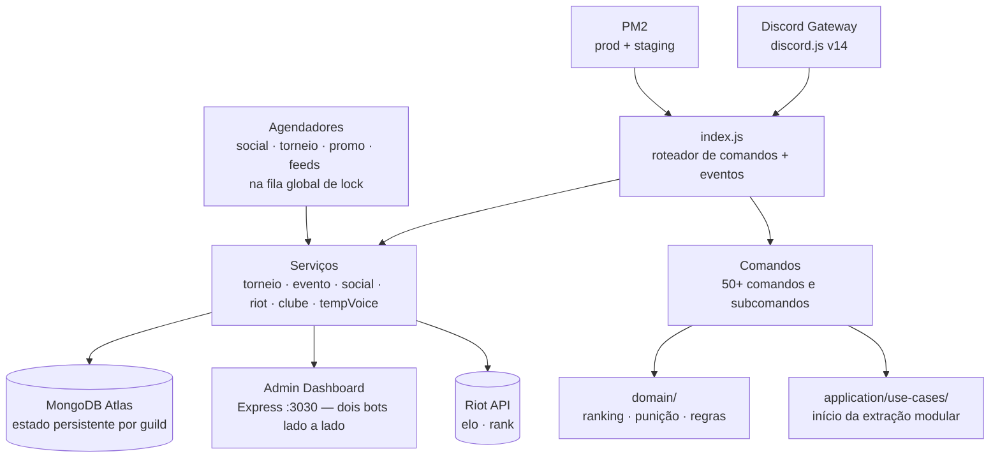

# 🎮 CAPS ARENA BOT

> **Sistema completo de gerenciamento de comunidade competitiva de League of Legends no Discord — matchmaking, ranking, torneios e clube de assinaturas, em produção 24/7 desde abril de 2026.**

*Full-featured Discord community management bot for competitive League of Legends: matchmaking, persistent ladders, automated tournaments and paid subscriptions — running in production (PM2 + MongoDB Atlas) since April 2026, developed and maintained solo.*

    

---

## O que ele faz

| Domínio | Funcionalidades |
|---|---|
| **Matchmaking** | Fila persistente 5v5 com painel de botões, balanceamento automático por elo (Riot API), salas de voz criadas e organizadas pelo bot |
| **Ciclo de partida** | Votação de resultado por botões (maioria real dos 10), MVP, ranking de PDL, temporadas arquiváveis, derrotas punidas com PDL |
| **Torneio automático** | Inscrição → sorteio de times fixos balanceados → fase de pontos (todos contra todos, confrontos em MD2) → final MD3 com escolha de lado pelo 1º colocado → coroação: cargo + hall da fama persistente |
| **Moderação** | Cadeia de ausência automática (5min aviso → 10min substituição → 20min W.O.), roleta de punição entre perdedores com custo em PDL, disciplina por desistência |
| **Monetização** | Clube VIP por assinatura (Mercado Pago: checkout + webhook assinado + concessão automática de benefícios), 3 tiers |
| **Multi-servidor** | Config por guild, bases de dados separadas por ambiente (produção/staging) e segundo bot irmão (LCL) espelhando os módulos de domínio |

## Destaques técnicos

**1. Corrida de escrita concorrente eliminada (lock próprio, sem framework de fila externo)**
   Múltiplos schedulers (social, torneio, clube, feeds) faziam `load → mutate → save` do MESMO documento de estado em janelas sobrepostas — o save de um reverte o slot do outro, a automação postava mensagens duplicadas e podia reverter estado do torneio. Solução: **fila global única de escrita** (`withQueueOperationLock`) unificando todas as janelas de meta + ticks sequenciais no scheduler. Zero duplicações desde o deploy.

**2. Estado que sobrevive a restart (durabilidade por design)**
   Nenhum timer/estado do fluxo crítico vive só em memória: cadeia de ausência, janelas de resultado (90min), assinaturas VIP e torneio em andamento nascem persistidos no MongoDB. O bot pode reiniciar (deploy, crash, PM2 upgrade) no meio de uma rodada **sem perder punição em andamento nem estado do torneio**.

**3. Feature flag de formato com rollback de 1 linha**
   O formato do torneio (mata-mata → fase de pontos) foi introduzido atrás de um default configurável (`TORNEIO_FORMATO_DEFAULT`): estados novos adotam o formato atual, estados antigos em andamento seguem no motor legado — **ambos os motores íntegros na mesma base**. Rollback para o formato anterior é literalmente mudar `'F1'` → `'legado'` e reiniciar.

**4. Testes antes de cada mudança, não depois**
   309 testes automatizados (53 suítes, `node:test` sem framework externo) incluindo: **paridade de API entre os dois bots espelhados** (CAPS×LCL — impede drift em módulos compartilhados), limites de embed do Discord, corridas de estado e fluxos completos ponta a ponta (inscrição → torneio → campeão).

## Arquitetura



- **Estado**: nenhum dado crítico em memória; Mongo Atlas é a fonte da verdade (`systemMeta` por guild).
- **Ambientes**: produção e staging em guilds/bancos separados, gerenciados pelo PM2.
- **Testabilidade**: suíte de paridade garante que módulos espelhados entre os dois bots não divergem silenciosamente.

## Stack

| Camada | Tecnologias |
|---|---|
| Runtime | Node.js 18+, discord.js v14 |
| Dados | MongoDB (Atlas), driver nativo com fila de escrita própria |
| Integrações | Riot API (elo/partidas), Mercado Pago (checkout + webhooks assinados) |
| Infra | PM2 (cluster prod/staging), Express (painel admin) |
| Qualidade | node:test — 309 testes / 53 suítes, testes de paridade, limites da API do Discord |

## Como rodar

```bash
git clone <repo>
npm install
cp .env.example .env    # preencha DISCORD_TOKEN, RIOT_API_KEY, MONGODB_URI
npm test                # 309 testes
npm start               # (PM2: pm2 start index.js --name caps-bot)
```

| Variável | Descrição |
|---|---|
| `DISCORD_TOKEN` | Token do bot Discord |
| `RIOT_API_KEY` | Chave da Riot Games API |
| `MONGODB_URI` | String de conexão Atlas |
| `MONGODB_DB` | Nome do banco (default: `caps-bot`) |
| `ADMIN_PORT` | Porta do painel admin (default: `3030`) |
| `MP_ACCESS_TOKEN` / `MP_WEBHOOK_SECRET` | Mercado Pago (clube VIP) |

## Repositório

```
├── index.js                    # gateway + eventos + roteador de comandos
├── commands/legacyCommands.js  # comandos em arquivo único (em extração modular)
├── services/                # torneio, evento, social, riot, clube, tempVoice…
├── domain/                  # regras: ranking, punição, views
├── application/             # use cases da extração modular
├── admin/                   # painel Express (dual-bot)
├── tests/                   # 53 suítes, 309 testes
└── scripts/                 # utilitários de setup e prévia de embeds (REST)
```

## Roadmap honesto

- [ ] Finalizar extração do monólito de comandos legados (~3k linhas) para use cases de domínio (estrutura já iniciada em `application/`)
- [ ] Migrar para TypeScript incremental (tipagem dos serviços mais críticos)
- [ ] Dockerfile + pipeline de CI (a suíte roda local e via runner)
- [ ] Métricas no painel admin (uso da fila, torneios realizados, assinaturas ativas)

## Capturas de tela

<!-- CHECKLIST DE CAPTURAS (descomente e atrele a path quando as imagens existirem em docs/img/):
1. Painel de fila com botões header (docs/img/fila.png)
2. Votação de resultado (docs/img/votar.png)
3. Embed do torneio — classificação da fase de pontos (docs/img/torneio.png)
4. Clube VIP (docs/img/clube.png)
5. GIF de 10s movendo os 10 para a sala de voz (docs/img/lobby.gif)
-->

## Contato

Precisa de um bot assim — ou de automação para o Discord de sua comunidade/empresa?

**Desenvolvo sob medida: bots de Discord, automação e integrações.** Prestador de serviço com MEI ativo (nota fiscal).

- 💼 LinkedIn: *[seu perfil]*
- 📧 E-mail: *[seu e-mail]*
- 🌐 GitHub: *[seu GitHub]*

---
⭐ Esse projeto é desenvolvido e mantido individualmente. Entre [issues](../../issues) se quiser discutir a arquitetura.
